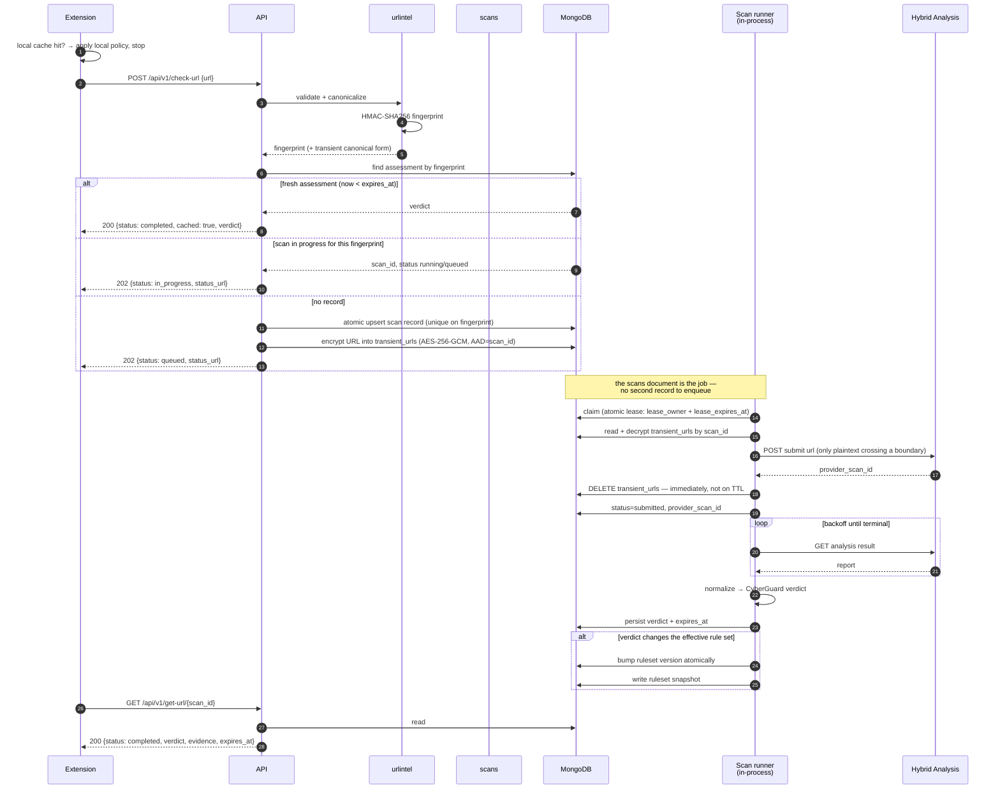
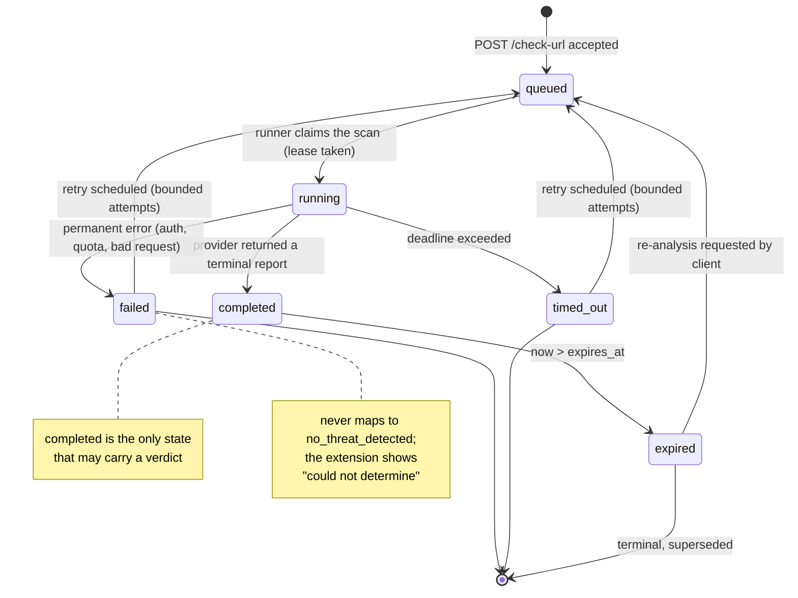

# CyberGuard AI — Architecture

> **Status:** Accepted. The twelve open questions raised by the review are now
> resolved by decision records in [`decisions/`](decisions/); see
> [§11 Decision records](#11-decision-records).
> **Scope:** Backend only. The browser extension is described where it affects
> the backend contract; its own architecture is out of scope.
> **Supersedes:** the backend-language and deployment statements in
> `docs/architecture/CYBERGUARD_PROJECT.md` and
> `docs/architecture/CYBERGUARD_ARCHITECTURE_PROMPT.md`. See
> [Conflicts found during review](architecture.md#7-conflicts-found-during-review).

## 1. Goals

CyberGuard AI answers one question for a browser extension: *is this URL known
or suspected to be malicious?* The backend's job is to answer quickly from
cached knowledge, to avoid wasting a scarce external scan budget on URLs it
has already judged, and to never let an inconclusive outcome be mistaken for
a safe one.

The system optimises, in order:

1. **Correctness of meaning.** A provider failure is not `no_threat_detected`.
   A stale verdict is not a fresh one. An unimplemented pipeline is not a clean
   scan. See [ADR 0011](decisions/0011-verdict-semantics-no-threat-detected.md).
2. **Bounded external cost.** Every remote submission is a metered, rate
   limited resource. A cache hit must be the common case.
3. **Privacy.** Raw URLs are treated as sensitive payloads, not as identifiers
   to store.
4. **Honest degradation.** When a dependency is down, the service says so in
   a machine-readable way rather than returning a reassuring default.

Non-goals for the MVP: a custom sandbox, a web dashboard, Elasticsearch,
identity management, and guaranteed real-time blocking.

### Authentication posture

**There is no application-level authentication in v1.** This is a decision, not
an omission: a browser extension cannot hold a secret that is not extractable
from its own package, so any credential shipped to the client is published.

Consequently the abuse threat is **quota consumption**, not data theft, and it
is answered by four mandatory controls — rate limits, quotas, request limits
and concurrency controls — none of which substitute for authentication.

The initial deployment is **private / self-hosted**, which is the primary
mitigation. See
[ADR 0014](decisions/0014-abuse-protection-without-authentication.md).

## 2. High-level architecture

A modular monolith. One Go module, **one long-running binary** (`api`) plus a
one-shot `migrate` tool, with MongoDB as both the authoritative store and the
work queue. The scan runner is background goroutines inside `api`, not a second
process ([ADR 0019](decisions/0019-mongodb-queue-and-in-process-runner.md)).

Redis was removed. It had been the job queue and the rate-limit backend
([ADR 0017](decisions/0017-redis-in-the-mvp.md), now superseded); the queue is
the ledger itself and the rate-limit counters are in-process.

```mermaid
flowchart TD
    EXT[Browser Extension<br/>Manifest V3<br/>unauthenticated] -->|POST /api/v1/check-url| API
    EXT -->|GET /api/v1/get-url/{id}| API
    EXT -->|GET /api/v1/get-all?version=N| API

    LIM[rate limit · quota ·<br/>concurrency controls<br/>ADR 0014 · in-process counters]

    subgraph Process["Go module (path per ADR 0016) — single process"]
        API[cmd/api<br/>HTTP transport]
        RUN[scan runner<br/>background goroutines]
        subgraph Mod["internal/ business modules"]
            UI[urlintel<br/>validate · canonicalize · fingerprint]
            SC[scans<br/>lifecycle · dedup · state machine]
            VD[verdicts<br/>provider → CyberGuard verdict]
            RS[rulesets<br/>version · generate · publish]
        end
        subgraph Prov["internal/providers"]
            PIF[AnalysisProvider interface]
            HAP[hybridanalysis<br/>adapter]
        end
        subgraph Plat["internal/platform"]
            MG[(MongoDB<br/>source of truth)]
            TU[(transient_urls<br/>AES-256-GCM · TTL minutes)]
        end
    end

    API --> LIM
    LIM --> SC
    API --> UI
    API --> RS
    SC --> UI
    SC --> MG
    SC --> TU
    RUN --> MG
    RUN --> TU
    RUN --> SC
    RUN --> PIF
    RUN --> VD
    VD --> RS
    HAP -.implements.-> PIF
    PIF --> HAP
    RS --> MG
    HAP -->|HTTPS| HA[Hybrid Analysis API v2]

    RS -->|GET /api/v1/get-all| EXT
```

The `scans` collection **is** the queue. A claim is a time-bounded lease on the
scan document itself: one atomic `FindOneAndUpdate` matches a claimable scan
(status active, `available_at` due or absent, lease absent or expired) and
stamps `lease_owner` and `lease_expires_at`, served by the `by_claimable` index.
There is no second record to keep in step with the ledger, and several replicas
compete for work safely without coordination.

Job payloads carry **scan IDs only**. Raw URLs are encrypted into
`transient_urls` and deleted immediately after submission
([ADR 0013](decisions/0013-durable-jobs-and-url-privacy.md)).

Trust boundaries are the process edges: the extension is untrusted input, the
provider is untrusted output, and MongoDB is trusted infrastructure that is
never published to the network.

## 3. URL analysis lifecycle



### Invariants

- **The fingerprint is the only lookup key for exact-URL state.** A raw URL
  exists in exactly two transient places: process memory, and the encrypted
  `transient_urls` record that is deleted the moment submission completes.
- **Job creation is idempotent per fingerprint.** Concurrent identical
  submissions must produce exactly one provider submission.
- **A claim is a lease, and the lease outlives the work.** The lease is derived
  as `WORKER_POLL_DEADLINE + WORKER_POLL_INTERVAL + CLAIM_LEASE_HEADROOM` and
  validated at config load, so no configuration can let one consumer claim a scan
  whose provider analysis is still running. A lapsed lease is not a failure: the
  scan simply becomes claimable again.
- **Scan status and verdict are independent axes.** A `running` scan has no
  verdict. A `failed` scan has no verdict.
- **No failure path produces `no_threat_detected`.** Timeout, auth failure,
  rate limit, malformed response and unknown status all resolve to
  `inconclusive` or `unknown`
  ([ADR 0011](decisions/0011-verdict-semantics-no-threat-detected.md)).

## 4. Scan state machine



State vocabulary conflict: `CYBERGUARD_PROJECT.md` §5.2 lists
`queued, submitting, submitted, running, completed, failed, timed_out`;
the review prompt §5 lists `queued, running, completed, failed, expired`.
This document adopts the **prompt's five states** and keeps
`submitting`/`submitted` as non-terminal *sub-states* of `running` recorded as
provider metadata rather than as public statuses. Rationale in
[ADR 0011](decisions/0011-verdict-semantics-no-threat-detected.md), which also
carries forward ADR 0004's state vocabulary and replaces its verdict names.

## 5. Ruleset synchronisation

The ruleset is a derived, versioned artefact. It is never a source of truth
and never contains every URL ever checked.

```mermaid
sequenceDiagram
    autonumber
    participant E as Extension
    participant A as API
    participant M as MongoDB
    participant R as Scan runner

    E->>A: GET /api/v1/get-all?version=7
    A->>M: read current ruleset snapshot
    alt snapshot.version == 7
        A-->>E: 200 {version: 7, unchanged: true}
    else no snapshot
        A-->>E: 200 {version: 0, rules: []}
    else version > 7
        A-->>E: 200 {version: 9, generated_at, rules: [...]}
        Note over E,A: ETag = "v9"; extension stores<br/>version and re-applies rules
    end
    R->>M: verdict becomes eligible for a rule
    R->>M: atomic $inc version, rebuild snapshot if changed
    Note over R,M: version increments only when the<br/>effective rule set actually changes
```

Eligibility is policy, not provider output. A verdict may be recorded without
producing a rule. See
[`security-and-privacy.md`](security-and-privacy.md#6-ruleset-policy).

## 6. Dependency failure behaviour

| Failure | API behaviour | Scan runner behaviour | Extension sees |
|---|---|---|---|
| MongoDB down | `/health/ready` → 503; API endpoints → 503 `service_unavailable` | cannot read assessments or transient URLs; leases lapse, so scans requeue once it returns | `could not determine`, never "safe" |
| Hybrid Analysis down | Readiness reports provider `degraded`, not a global 503 | retries with backoff, then `failed` | `could not determine` |
| API key missing/invalid | `check-url` → 503 `not_ready`; cached reads still work | refuses to submit | service unavailable |
| HMAC key missing | `/health/ready` → 503; `check-url` → 503 | no fingerprinting possible | service unavailable |
| URL encryption key missing | `/health/ready` → 503 | cannot decrypt; job fails with a typed error | `could not determine` |
| Rate limit exceeded | `429` + `Retry-After` | n/a | back off and retry |
| Quota exhausted | `503` + `Retry-After` — fail closed, never exceed the provider contract | drains queue, no new submissions | `could not determine` |

MongoDB down is now the single-datastore case. It is both the source of truth
and the queue, so one outage takes submission and analysis together rather than
leaving work stranded in a broker nobody is reading. The lease is what makes
that recoverable: a claim held by a process that died during the outage simply
expires, and the scan is claimable again.

The rate-limit and quota counters are **in-process**, which trades a shared
guarantee for one fewer thing that can fail while load-bearing. Stated plainly,
because it is not a small cost:

- Counters are per-process, so N replicas allow N times the configured rate.
- Counters reset on restart, so a crash is a free reset for every subject.

Neither is acceptable against a hard financial limit. If this ever scales out,
the counters move back to a shared store and `internal/ratelimit`'s interface
does not change — substitution is local to that package. Within a single
process the arithmetic, the `X-RateLimit-*` headers and the fail-closed
contract are exactly what they were.

Liveness never depends on MongoDB or the provider: a dependency outage must not
cause an orchestrator to restart every replica.

## 7. Conflicts found during review

**All ten are now resolved.** Each resolution below links the decision record
that closed it.

| # | Conflict | Sources | Resolution |
|---|---|---|---|
| 1 | Backend language: Laravel 12 vs Go | `CYBERGUARD_PROJECT.md` §0/§2/§13/§17, `CYBERGUARD_ARCHITECTURE_PROMPT.md` vs review prompt §2 | **Go is the only backend language.** [ADR 0009](decisions/0009-go-as-only-backend-language.md). Source documents retained as requirement records; their language statements superseded |
| 2 | Go is "not part of the MVP" | `CYBERGUARD_PROJECT.md` §2/§17 | Overturned by the review prompt. Recorded so the reversal is visible, not silent. See [ADR 0009](decisions/0009-go-as-only-backend-language.md) |
| 3 | Verdict vocabulary | `CYBERGUARD_PROJECT.md` §5.4 (`no_threat_detected`) vs review prompt §5 (`benign`) | **`no_threat_detected` adopted**; `benign` removed because it reads as a safety guarantee. Five verdicts: `malicious`, `suspicious`, `no_threat_detected`, `inconclusive`, `unknown`. [ADR 0011](decisions/0011-verdict-semantics-no-threat-detected.md), superseding [ADR 0004](decisions/0004-scan-and-verdict-vocabulary.md) |
| 4 | Scan state vocabulary | `CYBERGUARD_PROJECT.md` §5.2 (7 states) vs prompt §5 (5 states) | Five states; provider phases demoted to metadata. Carried forward in [ADR 0011](decisions/0011-verdict-semantics-no-threat-detected.md) |
| 5 | Repository layout | `CYBERGUARD_PROJECT.md` §4 (`apps/backend`, `apps/extension`) vs prompt §10 | Prompt's `cmd/` + `internal/` adopted. See [`module-map.md`](module-map.md) |
| 6 | Router | Prompt §2 "Chi router, if justified" vs prompt §2 "Go / net/http" | Standard library `http.ServeMux`, handlers handwritten. OpenAPI adopted as contract with a CI drift check instead of code generation. [ADR 0005](decisions/0005-standard-library-http.md) as amended by [ADR 0015](decisions/0015-openapi-and-rfc-9457.md) |
| 7 | MongoDB driver reference | `CYBERGUARD_PROJECT.md` §18 cites the **PHP** Laravel MongoDB driver | Obsolete. The official Go driver (`go.mongodb.org/mongo-driver/v2`) is used |
| 8 | Redis required vs optional | `CYBERGUARD_PROJECT.md` §13 vs prompt §2/§11 "only if required" | **Resolved by reversal.** Redis was made required by [ADR 0017](decisions/0017-redis-in-the-mvp.md), then removed: the scans collection is the queue and the rate-limit counters are in-process ([ADR 0019](decisions/0019-mongodb-queue-and-in-process-runner.md)). MongoDB is the only datastore |
| 9 | Health endpoint names | `CYBERGUARD_PROJECT.md` §5.7 (`/health/live`, `/health/ready`) vs Go convention (`/healthz`, `/readyz`) | Documented contract wins; already implemented that way |
| 10 | MongoDB major version | Compose pins `mongo:9.0`; docs say "MongoDB" generically | MongoDB 8.x cannot start on kernel ≥ 6.19 (SERVER-121912). Documented in [`docker-development.md`](docker-development.md) |

Two further contradictions were closed by later decisions rather than by this
review, and are listed here so the record is complete:

| # | Conflict | Resolution |
|---|---|---|
| 11 | Durable queue vs "never retain raw URLs" | Work is carried by the scan document itself, which carries a scan ID and no URL field; raw URLs encrypted in a short-lived collection and deleted immediately. [ADR 0013](decisions/0013-durable-jobs-and-url-privacy.md) as amended by [ADR 0019](decisions/0019-mongodb-queue-and-in-process-runner.md) |
| 12 | Unauthenticated API vs abuse exposure | Rate limits, quotas, request limits and concurrency controls are mandatory. [ADR 0014](decisions/0014-abuse-protection-without-authentication.md) |

## 8. Current implementation status

The repository contains a working skeleton built before this review. It is
preserved, not discarded.

| Area | State |
|---|---|
| `internal/config` | Implemented, tested by usage |
| `internal/logging` | Implemented (`log/slog` JSON) |
| `internal/urlintel` | Implemented and tested — validation, canonicalisation, HMAC fingerprints, PSL host intelligence |
| `internal/httpapi` | Implemented — routes, middleware, RFC 9457 errors, abuse controls |
| `internal/scans` | Implemented — lifecycle, dispatch, in-process consumer loop, reconciler, target gate |
| `internal/ratelimit` | Implemented — in-process fixed-window counters, fail closed |
| `internal/memstore` | Implemented — in-memory Store/Queue for tests |
| `cmd/api`, `cmd/migrate` | Implemented — graceful shutdown; the API runs the scan pipeline as goroutines. There is no `cmd/worker` |
| MongoDB persistence | Implemented — `scans` / `assessments` / `transient_urls`, indexes, migrations |
| Queue | Implemented — the `scans` collection, claimed by atomic lease (`by_claimable`); no broker |
| Transient URL encryption | Implemented — AES-256-GCM, scan ID as AAD |
| Provider adapter | Implemented and tested against a mock; **never against the live API** |
| Rulesets | Implemented — eligibility policy, DNR generation with full-snapshot validation, versioned immutable snapshots, ETag/conditional responses |
| Metrics / tracing | **Absent** (logs only) |
| OpenAPI document | Implemented — OpenAPI 3.1, drift-checked against the router |
| RFC 9457 error bodies | Implemented |

The topology this produces is one application process plus one datastore. That
is the point of [ADR 0019](decisions/0019-mongodb-queue-and-in-process-runner.md),
and the costs it accepts are recorded there and in §6 rather than glossed over.

Deliberate omissions, with reasons:

- **The Hybrid Analysis adapter has never called the live API.** Its contract
  was verified against the published OpenAPI document, and every test runs
  against a mock. Nine specification gaps remain open
  ([V1–V9](hybrid-analysis-integration.md#10-open-questions-requiring-manual-verification)),
  including the actual `verdict` string values, which need one controlled live
  call. Treat the verdict mapping as provisional until then.
- The Chrome extension is not built, and no client-side code of any kind was
  written. The ruleset **backend** is.
- There is no CI pipeline; every check is run by hand.
- The module path is `cyberguard/server`, which is not fetchable. It must be
  derived from the Git remote before the first external dependency is added —
  see [ADR 0016](decisions/0016-go-module-path.md).

## 9. Assumptions

| # | Assumption | Status |
|---|---|---|
| A1 | Hybrid Analysis permits automated URL submission under the project's licence and key tier | **Unverified — and it gates commercial release.** [ADR 0010](decisions/0010-hybrid-analysis-licensing.md) |
| A2 | Verdict freshness is measured in hours, not days | Assumption; TTLs are configuration |
| A3 | Traffic is modest (thousands of checks/day) | Assumption; modular monolith + single MongoDB is sufficient |
| A4 | The initial deployment is private / self-hosted, so network placement is a real mitigation | **Decision** — [ADR 0014](decisions/0014-abuse-protection-without-authentication.md) |
| A5 | No user accounts in v1, so there is no identity to breach | **Decision** — [ADR 0014](decisions/0014-abuse-protection-without-authentication.md) |
| A6 | Module path will be derived from a Git remote before publication | **Pending** — the repository is not yet a Git repository |
| A7 | Provider technical contract can be verified against official documentation before Phase 5 | **Unverified** — 15 open items, see [`hybrid-analysis-integration.md` §9](hybrid-analysis-integration.md#9-verification-checklist) |

## 10. Related documents

| Document | Contents |
|---|---|
| [`api-contract.md`](api-contract.md) | Endpoints, schemas, status codes, error format, rate limits |
| [`data-model.md`](data-model.md) | Collections, indexes, TTL, dedup, retention |
| [`module-map.md`](module-map.md) | Package layout, dependency direction, boundaries |
| [`security-and-privacy.md`](security-and-privacy.md) | Threat model, ruleset policy, redaction |
| [`hybrid-analysis-integration.md`](hybrid-analysis-integration.md) | Adapter design, verification checklist, open questions |
| [`docker-development.md`](docker-development.md) | Compose topology, health checks, local workflow |
| [`testing-strategy.md`](testing-strategy.md) | Test layers, fakes, acceptance criteria |
| [`implementation-plan.md`](implementation-plan.md) | Phases, risks, launch blockers |
| [`decisions/`](decisions/) | Architecture decision records |

## 11. Decision records

Every question raised by the architecture review is closed by a record in
[`decisions/`](decisions/). The full index, including supersession chains, is
in [`decisions/README.md`](decisions/README.md).

| ADR | Decision | Effect on this document |
|---|---|---|
| [0009](decisions/0009-go-as-only-backend-language.md) | Go is the only backend language | Closes conflict #1/#2 |
| [0010](decisions/0010-hybrid-analysis-licensing.md) | Usage approval required before commercial release | Gates Phase 5 and release |
| [0011](decisions/0011-verdict-semantics-no-threat-detected.md) | `no_threat_detected`, not `benign` | Closes conflict #3; supersedes ADR 0004 |
| [0012](decisions/0012-public-suffix-list-dependency.md) | `golang.org/x/net/publicsuffix` | First external dependency; removes the `TODO` |
| [0013](decisions/0013-durable-jobs-and-url-privacy.md) | Scan IDs in the queue; encrypted transient URLs | Supersedes ADR 0003; closes conflict #11 |
| [0014](decisions/0014-abuse-protection-without-authentication.md) | No auth in v1; four mandatory controls | Closes conflict #12; drives the failure table |
| [0015](decisions/0015-openapi-and-rfc-9457.md) | OpenAPI contract, RFC 9457 errors | Amends ADR 0005; absorbs ADR 0006 |
| [0016](decisions/0016-go-module-path.md) | Module path from the Git remote | Must happen before Phase 3 |
| [0017](decisions/0017-redis-in-the-mvp.md) | Redis is required | **Superseded** by ADR 0019; closes conflict #8 |
| [0018](decisions/0018-ruleset-thresholds-and-scope.md) | Ruleset thresholds and scope | Bounds how broad a published rule may be |
| [0019](decisions/0019-mongodb-queue-and-in-process-runner.md) | The scans collection is the queue; the API runs the pipeline | Reverses ADR 0017; drives §2, §6 and §8 |

One launch blocker remains, recorded as an ADR because it changes what the
system may do rather than merely what it builds:

1. **Hybrid Analysis usage approval** — [ADR 0010](decisions/0010-hybrid-analysis-licensing.md).

The Redis blocker that stood here — `maxmemory-policy noeviction`, so that an
eviction policy could not silently drop queued jobs — is gone with Redis. There
is no in-memory queue left to evict.

The fifteen provider-specific technical questions remain open and cannot be
closed by any decision; see
[`hybrid-analysis-integration.md` §9](hybrid-analysis-integration.md#9-verification-checklist).