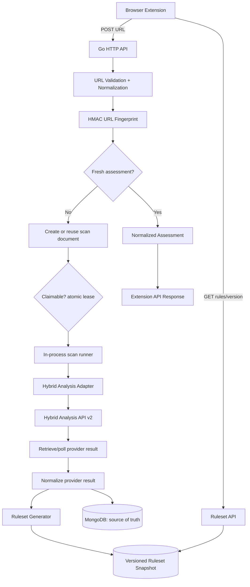

# CyberGuard AI — Project Architecture & Technical Plan

**Version:** 1.1  
**Status:** Initial implementation specification  
**Product:** Open-source URL threat-checking backend + browser extension  
**Backend language:** Go  
**Primary analysis provider:** Hybrid Analysis API v2  
**Database:** MongoDB  
**Work queue:** the `scans` collection itself — claimed with a time-bounded lease  
**Deployment:** Docker Compose (`backend` + `mongodb`)  
**Search engine:** Elasticsearch is optional and deferred until a concrete requirement exists

---

## 1. Project summary

CyberGuard AI is an open-source URL threat-checking backend used by a browser extension. The extension checks its local cache first. If it has no suitable result, it asks the Go backend to check the URL. The backend reuses a fresh stored assessment when possible; otherwise, it creates an asynchronous analysis job and submits the URL to Hybrid Analysis when the configured API key and provider terms permit that workflow.

The backend normalizes provider results into CyberGuard's own verdict model, stores privacy-conscious metadata and a keyed URL fingerprint, and publishes a versioned browser ruleset when an assessment justifies a rule.

**Important scope distinction:** Go is the backend API and orchestration language. Hybrid Analysis is still the external sandbox provider. Rewriting the backend in Go does not make Hybrid Analysis's remote sandbox execute faster; Go gives CyberGuard one backend language and can handle concurrent API and scan-pipeline tasks efficiently.

### Product principles

1. **Fast path first:** Reuse fresh results; do not start a new remote scan for every request.
2. **Asynchronous analysis:** Do not keep the original HTTP request open for the full analysis lifecycle.
3. **Keep secrets server-side:** Never embed the Hybrid Analysis API key in the extension or frontend assets.
4. **Privacy-conscious storage:** Do not persist raw URLs by default. Use a backend-keyed HMAC fingerprint and redact URLs from logs. The actual URL may be needed transiently for provider submission; minimize its lifetime and protect any stored copy that temporarily contains it.
5. **Clear verdict semantics:** Use `malicious`, `suspicious`, `no_threat_detected`, and `unknown`. Scan status (`queued`, `running`, etc.) is separate from the verdict. Provider errors and timeouts must never be treated as safe.
6. **Rules are not scan records:** The extension's block/redirect rules are a generated, versioned output—not the database itself.
7. **No broad crawling by default:** Analyze the submitted URL and redirects observed by the provider. Do not enumerate arbitrary paths or subdomains unless the target is owned by, or explicitly authorized for testing by, the organization.
8. **Modular monolith first:** Keep one Go codebase with clear internal module boundaries, and run it as **one process**. The API serves HTTP and runs the scan pipeline on its own goroutines. The decoupling that matters is between the request and the analysis, not between two processes: `check-url` returns `202` immediately and a detonation that takes minutes never holds a connection open, because no request is waiting on it.

## 2. MVP scope

### Included

- Go HTTP API with versioned JSON endpoints.
- MongoDB as the source of truth, with indexed URL fingerprints.
- Hybrid Analysis API v2 client behind a provider interface.
- Asynchronous scan lifecycle and duplicate-job prevention.
- URL validation, safe normalization, domain extraction, and HMAC fingerprinting.
- Versioned ruleset endpoint for the browser extension.
- Scan status/result endpoint.
- Docker Compose development environment.
- Health/readiness checks, structured logs, request/scan correlation IDs, and URL redaction.
- Tests for validation, cache hits/misses, duplicate requests, provider failures, and ruleset versioning.

### Explicitly out of scope for the initial MVP

- Building a custom browser sandbox or browser execution farm.
- Scanning every possible path or enumerating every subdomain of a domain.
- Employee accounts, Active Directory, SSO, or a security dashboard unless separately scoped.
- Elasticsearch as a dependency for exact URL fingerprint lookups.
- Guaranteed interception/blocking of every browser navigation. An ordinary extension cannot transparently pause every kind of navigation while waiting for remote analysis; stronger enforcement may require a managed web gateway or network proxy.
- A separate Go microservice solely to call Hybrid Analysis. The Go API calls the provider directly through a provider adapter, and runs the analysis on its own goroutines.

## 3. High-level architecture



### Component responsibilities

- **Browser extension:** Maintains a bounded local verdict cache and installed ruleset version, requests checks, retrieves scan status, synchronizes rules, and applies supported `declarativeNetRequest` rules.
- **Go HTTP API:** Request validation, routing, rate limiting, scan creation/reuse, status responses, ruleset delivery, and health endpoints.
- **URL Intelligence:** URL validation, carefully defined normalization, hostname/registrable-domain extraction, and HMAC fingerprinting.
- **Scan Management:** Cache lookup, idempotency, state transitions, duplicate-scan prevention, timeouts, and retry decisions.
- **Scan runner (goroutines inside the API process):** Claims scans by lease and coordinates submission/polling without blocking any HTTP request. It shares the binary, not the request path.
- **Hybrid Analysis adapter:** Contains all provider-specific authentication, endpoints, request/response types, polling rules, and provider-error translation.
- **Verdict Normalization:** Converts external provider data into CyberGuard's stable result format.
- **Rulesets:** Produces and validates versioned browser rules based on eligible findings.
- **MongoDB:** Authoritative store for scan records, assessment metadata, provider references, and ruleset snapshots — and the work queue. A scan is work by being claimable, and claiming is an atomic lease on the scan document, so there is no second datastore and no second source of truth about pending work.
- **Elasticsearch (optional later):** Derived index for large-scale indicator/report search. It is not needed for the primary exact-fingerprint lookup.

## 4. Recommended repository structure

Use idiomatic Go packaging and keep business modules under `internal/` so implementation details are not imported by external applications. Adapt an existing repository's layout if it already has sensible conventions.

```text
cyberguard-ai/
├── cmd/
│   ├── api/
│   │   └── main.go                 # Serves the HTTP API and runs the scan pipeline
│   └── migrate/
│       └── main.go                 # One-shot index/schema step
├── internal/
│   ├── config/                     # Environment/config parsing and validation
│   ├── transport/
│   │   └── httpapi/
│   │       ├── router.go
│   │       ├── middleware/
│   │       ├── handlers/
│   │       ├── requests/
│   │       └── responses/
│   ├── modules/
│   │   ├── urlintel/               # Validation, normalization, fingerprints, domains
│   │   ├── scans/                  # Scan use cases, state transitions, deduplication
│   │   ├── providers/
│   │   │   └── hybranalysis/       # Provider client, DTOs, polling and errors
│   │   ├── verdicts/               # Canonical verdict model and mapping
│   │   ├── rulesets/               # Browser rules generation and versioning
│   │   └── health/                 # Liveness/readiness use cases
│   ├── platform/
│   │   ├── mongodb/                # MongoDB client, repositories, indexes, claim leases
│   │   ├── queue/                  # Delivery interface + MongoDB adapter over `scans`
│   │   └── observability/          # Logger, metrics, correlation IDs
│   └── app/                        # Dependency wiring and service composition
├── extension/                      # Separate browser-extension project/build
│   ├── src/
│   │   ├── background/
│   │   ├── popup/
│   │   ├── checking-page/
│   │   ├── blocked-page/
│   │   ├── api/
│   │   ├── rules/
│   │   └── storage/
│   └── manifest.json
├── docs/
│   ├── architecture.md
│   ├── api-contract.md
│   ├── data-model.md
│   ├── module-map.md
│   ├── security-and-privacy.md
│   ├── implementation-plan.md
│   └── decisions/
├── deploy/
│   ├── Dockerfile
│   └── compose.yaml
├── .env.example
├── .gitignore
├── go.mod
├── go.sum
└── README.md
```

### Suggested foundational libraries

- **HTTP:** Go standard library `net/http`; consider `github.com/go-chi/chi/v5` for composable routing/middleware without hiding standard HTTP semantics.
- **MongoDB:** Official Go driver (`go.mongodb.org/mongo-driver/v2/mongo`). Verify the driver's Go-version requirement against the Go toolchain selected for the repository.
- **Queue:** Use a small internal delivery interface, and keep the
  implementation in MongoDB. A scan becomes work by being claimable, and a claim
  is a time-bounded lease stamped by one atomic `findAndModify` — exclusivity
  and recovery both come from the server, with no sweeper and no promoter. Do
  not reintroduce a broker to make the asynchronous property true; the property
  is that no HTTP request waits on an analysis, and it holds with goroutines in
  the same process. If a broker is ever justified by measured load, keep the
  interface and reimplement it behind it.
- **Configuration:** Read environment variables through a small validated config package; avoid a large configuration framework unless needed.
- **Logging:** Use structured logging from the Go standard library (`log/slog`) unless an observed requirement justifies another logger.

Do not create interfaces for every function. Add interfaces at boundaries that need substitution or test doubles: repository, analysis provider, delivery, and clock where expiration tests benefit from it.

## 5. Modules and boundaries

### 5.1 `urlintel` — URL Intelligence

**Purpose:** Validate and describe a URL without making provider calls.

Responsibilities:
- Accept only `http` and `https` schemes.
- Reject malformed URLs, embedded credentials, unsupported schemes, and overlong input.
- Normalize deterministically for fingerprinting while preserving meaningful path/query distinctions.
- Remove the fragment from the server-side request identity because fragments are not sent in HTTP requests; document and test this policy.
- Extract hostname and registrable domain with a Public Suffix List-aware library, not a naive “last two labels” algorithm.
- Generate `HMAC-SHA-256` fingerprints using a backend-only secret.
- Never assume different paths or query strings are equivalent unless an explicit, tested policy says so.

Do not casually lowercase paths, remove query parameters, or reorder query values; URL paths and query parameters may affect behavior and may contain sensitive values.

### 5.2 `scans` — Scan Management

**Purpose:** Own scan lifecycle, cache behavior, and idempotency.

Responsibilities:
- Look up a fresh assessment by URL fingerprint.
- Deduplicate concurrent requests for the same fingerprint.
- Create a scan record; work is claimed from that record by lease.
- Track scan states: `queued`, `submitting`, `submitted`, `running`, `completed`, `failed`, `timed_out`.
- Track attempt count, next retry time, provider scan ID, timestamps, and safe error codes.
- Expose status/result by opaque scan ID.
- Prevent repeated client requests from creating unlimited provider submissions.
- Treat cache expiration as a policy/configuration choice, not a permanent safety guarantee.

Deduplication is enforced by a partial unique index in MongoDB, not by a
read-then-write check, so it does not depend on the application behaving
correctly under a race. Claiming works the same way for the same reason.

### 5.3 `providers/hybranalysis` — Provider integration

**Purpose:** Isolate provider-specific behavior behind a small internal contract.

Suggested Go interface (illustrative; adapt naming to the repository):

```go
type URLAnalysisProvider interface {
    SubmitURL(ctx context.Context, rawURL string) (Submission, error)
    GetAnalysis(ctx context.Context, providerScanID string) (ProviderReport, error)
}
```

Provider adapter responsibilities:
- API base URL and authentication header.
- Exact supported endpoints and request payloads, verified from the current official API v2 docs.
- HTTP client timeouts and response-size limits.
- Provider DTOs separate from internal data models.
- Polling intervals, provider rate limits, terminal statuses, and `Retry-After` behavior.
- Mapping provider failures into safe internal error categories.

Do not spread provider response field names across the codebase. Keep the key in server-side environment configuration or a secret manager. Confirm the API key is permitted to make automated URL submissions before production use.

### 5.4 `verdicts` — Verdict normalization

**Purpose:** Convert provider output to CyberGuard's stable assessment vocabulary.

Canonical verdicts:
- `malicious`
- `suspicious`
- `no_threat_detected`
- `unknown`

Scan state is independent of verdict. A running job has no final verdict. A provider error or incomplete scan must not be converted into `no_threat_detected`.

Store evidence only when it is present in the actual provider response and permitted by provider terms. A clean result means only that the analysis did not identify sufficient threat indicators; it is not proof of safety.

### 5.5 `rulesets` — Extension rule generation

**Purpose:** Convert eligible, current assessments into browser-compatible rules.

Responsibilities:
- Own a monotonically increasing ruleset version.
- Generate and validate supported Chrome `declarativeNetRequest` rules.
- Publish a snapshot with `version`, `generated_at`, and `rules`.
- Increment the version only when effective rules change.
- Support version comparison and/or ETag-based conditional downloads.
- Remove or expire rules when assessments expire or are revoked.
- Never create a block/redirect rule from `unknown`, provider error, expired, or ambiguous findings.

The extension ruleset must not simply be a list of every checked URL. Domain-level rules can affect many pages; prefer the narrowest scope supported by the browser and justified by evidence. Validate rule counts and semantics against current browser limits.

### 5.6 `httpapi` — HTTP transport

**Purpose:** HTTP handlers, request validation, rate limiting, serialization, and errors.

Handlers should remain thin: parse and validate input, invoke module/use-case methods, and serialize the result. Provider polling, cache logic, Mongo queries, and rules generation should not live directly in handler functions.

### 5.7 `observability` and `health`

Provide:
- `GET /health/live`: process is alive.
- `GET /health/ready`: required dependencies can be reached.
- Structured logs with request/scan correlation IDs.
- Metrics for cache hit rate, time from scan creation to first claim, provider latency, retries, failures, timeouts, and polling volume.
- Redaction of raw URLs, query strings, API keys, and provider secrets.
- Graceful shutdown with bounded timeouts. The listener stops accepting first, then the scan runner, then MongoDB — in that order, so a runner still polling while the store disconnects cannot turn a clean shutdown into a burst of failed scans.

## 6. API contract

Use versioned routes. The requested names are retained below, while their purposes are explicit.

### 6.1 `POST /api/v1/check-url`

Checks for a usable assessment or creates/reuses an asynchronous scan.

Request:

```json
{
  "url": "https://example.test/login"
}
```

If a fresh assessment exists (`200 OK`):

```json
{
  "scan_id": "scan_01ABC",
  "status": "completed",
  "cached": true,
  "verdict": "suspicious",
  "expires_at": "2026-10-17T12:00:00Z"
}
```

If the scan is queued (`202 Accepted`):

```json
{
  "scan_id": "scan_01XYZ",
  "status": "queued",
  "cached": false,
  "status_url": "/api/v1/get-url/scan_01XYZ"
}
```

Examples are illustrative. Use reserved test domains for automated tests.

### 6.2 `GET /api/v1/get-url/{scanId}`

Returns the current state and, when available, the normalized result. Use an opaque scan ID instead of a full URL in the route.

```json
{
  "scan_id": "scan_01XYZ",
  "status": "completed",
  "verdict": "malicious",
  "provider": "hybrid-analysis",
  "evidence": [
    {
      "type": "provider_verdict",
      "summary": "Provider returned a malicious classification"
    }
  ],
  "analyzed_at": "2026-10-16T12:00:00Z",
  "expires_at": "2026-10-17T12:00:00Z"
}
```

Never fabricate evidence. Populate it only from actual provider output normalized by the provider adapter.

### 6.3 `GET /api/v1/get-all?version={clientVersion}`

Returns the current **browser ruleset**, not every URL stored in MongoDB.

If the client's ruleset is unchanged, use `304 Not Modified` with `ETag`/`If-None-Match`, or return a documented small unchanged response. Otherwise:

```json
{
  "version": 12,
  "generated_at": "2026-10-16T12:00:00Z",
  "rules": []
}
```

Validate the generated rule format before publishing. Do not expose raw URLs or unrelated scan records in the rules response.

### 6.4 General API behavior

- Use request body size limits and URL length limits.
- Apply rate limiting and duplicate-job controls.
- Return consistent JSON error objects.
- Do not expose provider keys, raw provider headers, stack traces, or infrastructure details.
- CORS is not authentication; before public deployment, define an abuse-control and client-trust strategy appropriate to the product.
- Avoid raw URLs in route paths and query strings because they can leak into proxies and logs.

## 7. MongoDB data model

MongoDB is the authoritative store.

### `url_assessments` collection

Suggested document:

```json
{
  "_id": "assessment_01ABC",
  "url_fingerprint": "hmac-sha256-value",
  "hostname": "example.test",
  "registrable_domain": "example.test",
  "verdict": "suspicious",
  "scan_status": "completed",
  "provider": "hybrid-analysis",
  "provider_scan_id": "provider-id",
  "evidence_summary": [],
  "analyzed_at": "2026-10-16T12:00:00Z",
  "expires_at": "2026-10-17T12:00:00Z",
  "created_at": "2026-10-16T12:00:00Z",
  "updated_at": "2026-10-16T12:00:00Z"
}
```

Raw URL is deliberately absent. The raw URL is needed temporarily for provider submission. It is held only in a short-lived encrypted record: encrypt, minimize retention, restrict access, and ensure logs never print it. Delete the transient value as soon as submission no longer requires it. A fingerprint is not encryption and does not guarantee anonymity.

Suggested indexes:
- Unique index on `url_fingerprint` for exact-URL assessments.
- Index on `hostname` for host-level lookups.
- Index on `registrable_domain` for domain intelligence.
- Index on `expires_at` for selecting expired assessments and cleanup where deletion is appropriate.
- Index on `scan_status` and timestamps for job recovery and operational queries.

Keep exact-URL verdicts separate from hostname/domain reputation. Do not infer that all paths or subdomains are safe or malicious based solely on one URL's result.

### Scan documents are the work queue

The `scans` document carries three claim fields alongside its lifecycle state:

```json
{
  "_id": "scan_01ABC",
  "status": "running",
  "available_at": "2026-10-16T12:00:05Z",
  "lease_owner": "api-6f4c1/41",
  "lease_expires_at": "2026-10-16T12:05:35Z"
}
```

| Field | Meaning |
|---|---|
| `available_at` | When this scan next becomes claimable. Absent means due now. A deferred retry is just a future value here. |
| `lease_owner` | Which process holds it. Diagnostic only — a lease is released by expiry, not by matching this string. |
| `lease_expires_at` | When the claim lapses. Absent or null means unclaimed. |

Back them with an index on `{status, available_at, lease_expires_at}`. Without
it, claiming is still correct but degrades into a collection scan over all
history, so the queue gets slower the more it has been used.

A claim is one atomic `findAndModify` that matches a claimable scan and stamps
the lease in the same operation, which is what makes it exclusive: a second
claimant matches nothing. Nothing enforces that a consumer which dies releases
anything, so the lease is time-bounded and **the clock is the recovery
mechanism** — no sweeper, no reaper, no reconciler for delivery.

The lease must be longer than the longest possible unit of work (a provider
poll), or a second consumer could start a scan whose analysis is still running.
Derive it from the poll deadline plus a configured headroom rather than letting
it be set independently, so no configuration produces a double submission.

A job record may contain scan metadata, status, attempt count, timestamps, provider scan ID, and a reference to an encrypted short-lived submission payload if necessary. Avoid storing a long-lived copy of raw URLs. Define cleanup behavior and recovery of jobs after a consumer restart.

## 8. Elasticsearch decision

Do **not** make Elasticsearch a required MVP dependency for exact fingerprint lookup. MongoDB's indexed lookup is sufficient for that workflow.

Consider Elasticsearch later if the product needs large-scale cross-report searching, IOC exploration, complex filtering, or search across normalized security evidence. If added, treat it as a rebuildable derived index, not the source of truth. Avoid maintaining a second index until query volume and real use cases justify its operational cost.

## 9. Scan lifecycle and reliability

Suggested sequence:

1. Accept the request and validate the URL.
2. Apply URL normalization and compute the HMAC fingerprint.
3. Look up a fresh assessment.
4. If one exists, return it without provider submission.
5. If a scan for the same fingerprint is already in progress, return/reuse its scan ID.
6. Otherwise, create a scan. It is claimable the moment it exists — there is no
   separate enqueue step that can succeed or fail independently.
7. The in-process scan runner claims it by lease, reads the encrypted URL, and
   submits it through the Hybrid Analysis adapter, if permitted by key privileges
   and provider terms.
8. Persist the provider scan ID and status.
9. Poll according to current documented provider behavior and rate limits, using bounded backoff.
10. Normalize the provider's terminal result.
11. Persist the assessment and expiry.
12. Regenerate/publish the ruleset only when the effective rules change.
13. Client polls the status endpoint or uses a future push mechanism if added later.

Step 6 returning before step 7 begins is the whole asynchronous property. The
client got `202` while no analysis existed yet; the analysis then runs on the
API's own goroutines. A detonation measured in minutes changes nothing about how
long an HTTP connection is held open, because none is waiting on it.

Reliability requirements:
- Use request-level and provider-level timeouts.
- Respect `Retry-After` when present.
- Retry transient network errors and selected 5xx/429 responses with bounded backoff.
- Do not retry invalid requests or authorization failures indefinitely.
- Prevent duplicate submissions for concurrent equivalent requests.
- Use idempotency keys or atomic conditional updates where appropriate.
- Provide graceful shutdown and recovery of work abandoned by a killed process —
  here, lease expiry rather than a queue reconciler.
- Make TTL/expiry values configurable and verdict-aware; a cached result is not a permanent guarantee of safety.

## 10. Browser extension integration

- Keep a bounded local cache of recent verdicts and the installed ruleset version.
- Use extension-supported storage APIs such as `chrome.storage.local`, not page `localStorage`, for extension-owned state.
- Fetch the ruleset only when its version changes, using version comparison and/or conditional requests.
- Validate rule formats and counts before applying them.
- Apply rules using the supported browser API such as Chrome's `declarativeNetRequest`.
- Only create rules from eligible, current findings and use the narrowest justified scope.
- Do not assume the extension can transparently pause every type of navigation while awaiting a remote API. Strict enforcement may require a managed proxy or secure web gateway.
- Never include the Hybrid Analysis API key in extension JavaScript, storage, configuration bundled with the extension, or frontend build variables.

## 11. Security and privacy requirements

1. Accept only HTTP/HTTPS URL schemes and reject malformed or credential-bearing URLs.
2. Avoid fetching arbitrary URLs from the backend itself; provider submission is different from server-side browsing. If self-fetching is introduced later, design explicit SSRF-safe egress controls.
3. Do not enumerate arbitrary paths or subdomains. Analyze the submitted URL and provider-observed redirects by default.
4. Do not retain raw URLs by default. Where transient retention is unavoidable, encrypt, minimize lifetime, and restrict access.
5. Redact URLs/query strings, API keys, and secrets from logs, traces, errors, and analytics.
6. URLs submitted to Hybrid Analysis are disclosed to an external service. Do not send confidential internal URLs without authorization and provider-term review.
7. Protect the API from abuse with request limits, rate limits, quotas, and an appropriate client trust strategy.
8. Treat provider responses as untrusted input: validate schema, lengths, identifiers, and status values.
9. Never turn `unknown`, timeout, or provider error into a safe verdict.
10. Keep dependency and image updates part of maintenance.
11. Do not expose MongoDB or Elasticsearch ports publicly by default. The API is the only published port.
12. Use non-root containers, minimal images, read-only filesystems where practical, and graceful shutdown.
13. Avoid mounting the Docker socket into any application container.

## 12. Configuration and secrets

Example `.env.example` (names may be adjusted during implementation):

```env
APP_ENV=local
HTTP_ADDR=:8080
LOG_LEVEL=info

MONGODB_URI=mongodb://mongodb:27017
MONGODB_DATABASE=cyberguard

HYBRID_ANALYSIS_BASE_URL=https://www.hybrid-analysis.com/api/v2
HYBRID_ANALYSIS_API_KEY=
URL_FINGERPRINT_HMAC_KEY=
URL_ENCRYPTION_KEY=

# Claim pacing and lease sizing for the in-process scan runner.
# The lease is derived from the poll deadline plus the headroom and validated at
# startup, so there is no setting that can produce a double submission.
WORKER_POLL_DEADLINE=5m
WORKER_CLAIM_POLL_GAP=250ms
CLAIM_LEASE_HEADROOM=30s

ELASTICSEARCH_ENABLED=false
ELASTICSEARCH_URL=http://elasticsearch:9200
```

Rate-limit counters are in-process, so no Redis configuration exists. That is
the one trade this brings: the configured limits are **per replica**, and a
restart resets them. Acceptable at one replica; not acceptable against a hard
financial ceiling at several.

Never commit `.env`, production API keys, HMAC keys, or production secrets. Use separate local and production credentials. Verify exact provider endpoint paths, required headers, payload parameters, and automated-submission permissions against the official API v2 documentation before implementing the real client.

## 13. Docker Compose topology

Actual services:
- `backend`: Go process serving the HTTP API **and** running the scan pipeline.
- `mongodb`: source-of-truth data store, and the work queue.
- `migrate`: one-shot index creation, run before the API starts.

Optional later service:
- `elasticsearch`: derived search index only when justified.

Requirements:
- Internal services connect through Compose service names such as `mongodb`, not `localhost` from another container.
- Publish only the API port for local development by default.
- Keep MongoDB and Elasticsearch on an internal network.
- Add health checks and dependency readiness handling.
- Use persistent volumes for MongoDB; document that volumes alone are not backups.
- Use multi-stage Docker builds, minimal runtime images, and a non-root user where practical.
- Avoid mounting the Docker socket into application containers.
- Ship one binary. A second one is not a scaling lever here: replicas already
  contend for work safely through the lease, and splitting analysis into its own
  process would re-introduce the second source of truth that the lease removed.

Note what is *not* required, because it is easy to assume a queue broker is
involved: there is no broker service, no queue container, and no queue process.
A scan is work by being claimable in MongoDB.

## 14. Testing strategy

### Unit tests
- URL validation and normalization.
- HMAC fingerprint stability and secret handling.
- Domain extraction for public suffix edge cases.
- Provider response-to-verdict mapping.
- Ruleset generation and version changes.
- Expiration and state-transition rules.

### Integration tests
- A fresh cached assessment returns without provider submission.
- A cache miss creates exactly one claimable scan.
- Concurrent duplicate requests reuse an in-progress scan.
- MongoDB indexes are created and used as expected.
- **A claim is exclusive against a real MongoDB.** This is a property of the
  server, not of our code, so no in-memory double can stand in for it.
- **A lapsed lease becomes claimable again with nothing running to notice** — the
  recovery path a killed consumer leaves behind.
- A scan with no claim fields at all is still claimable, so documents written
  before those fields existed are never stranded.
- A consumer recovers after transient provider errors.
- Provider 401, 403, 429, 5xx, timeout, malformed payload, and unknown status are handled safely.
- Raw URLs and secrets are absent from logs.
- Ruleset endpoint returns unchanged state when the version is current and a new snapshot when rules change.

The integration suite needs MongoDB and nothing else. There is no second
datastore to start.

### Extension tests
- Valid rules snapshots are applied.
- Unchanged rulesets are not downloaded repeatedly.
- Malformed or unsupported rules are rejected.
- Backend offline/timeouts result in `unknown`/inconclusive UX rather than “safe”.

Use mocked provider responses for automated tests. Do not submit arbitrary live URLs during test runs.

## 15. Implementation milestones

### Milestone 1 — Go foundation
- Initialize `go.mod` and the repository layout.
- Select and pin compatible versions of Go dependencies.
- Add configuration validation, `log/slog`, HTTP router, graceful shutdown, and health endpoints.
- Add Docker Compose with the API and MongoDB.
- Add CI format/lint/test commands (`gofmt`, `go vet`, unit tests, and any selected linter).

### Milestone 2 — URL Intelligence + MongoDB
- Implement URL validation and tested normalization rules.
- Implement HMAC fingerprinting.
- Implement MongoDB connection, repositories, indexes, and assessment lookup.
- Add cache-hit behavior and expiry handling.

### Milestone 3 — Scan Management + claim queue
- Define scan states and transitions.
- Implement atomic deduplication for concurrent requests.
- Add the delivery adapter over the `scans` collection: atomic claim, lease,
  expiry, retry deferral.
- Run the scan pipeline on goroutines inside the API process.
- Implement safe retry/backoff and provider failure mapping.

### Milestone 4 — Hybrid Analysis adapter
- Verify API-key permissions and automated-submission requirements.
- Implement the provider client from the current official API v2 contract.
- Add mocked provider tests and polling behavior.
- Normalize provider results into internal verdicts.

### Milestone 5 — Ruleset API
- Generate supported browser rules.
- Publish a monotonically versioned snapshot.
- Add version/ETag-based synchronization.
- Ensure rule scope is narrow and only supported verdicts create rules.

### Milestone 6 — Extension integration
- Connect extension to `POST /check-url`.
- Implement scan-status polling/checking page.
- Cache recent verdicts locally.
- Download and apply versioned dynamic rules.

### Milestone 7 — Hardening
- Rate limits, timeouts, provider quotas, URL/log redaction, metrics, recovery tests, and security review.
- Add Elasticsearch only if measured search requirements justify it.
- Consider a custom Go sandbox orchestrator only if CyberGuard plans to replace or supplement the external analysis provider.

## 16. Definition of done for MVP

- A URL sent by the extension reaches the Go API.
- Invalid URL schemes and malformed inputs are rejected.
- A fresh cached result is reused without duplicate provider submission.
- A cache miss creates one claimable scan.
- No HTTP request is held open while an analysis runs.
- Provider responses map to CyberGuard's stable scan-state/verdict model.
- The extension can retrieve scan status and a completed assessment.
- The extension downloads only changed rulesets.
- Failed, expired, and inconclusive results are never mislabeled as safe.
- API keys remain server-side and do not appear in logs.
- MongoDB's port is not exposed publicly by default.
- Tests cover cache behavior, concurrent deduplication, provider errors, and ruleset versioning.

## 17. Architecture decisions

| Decision | Initial choice | Reason |
|---|---|---|
| Backend | Go modular monolith | One language, one process, explicit module boundaries |
| HTTP | `net/http`, optionally with `chi` | Idiomatic HTTP and small routing layer |
| Sandbox | Hybrid Analysis API | Avoid building and securing a custom sandbox in the initial version |
| Data store | MongoDB | Flexible provider metadata and indexed assessment lookup |
| Queue | The `scans` collection; delivery by time-bounded lease | The ledger already knew what work existed, so a broker was a second source of truth about it. A lease keeps long-running provider work off the request path with one fewer process and one fewer failure mode |
| Search | MongoDB indexes first; Elasticsearch optional | Avoid unnecessary infrastructure for exact lookups |
| Raw URLs | Not retained by default | Reduces exposure of sensitive query parameters and tokens |
| Scan execution | Asynchronous, in-process goroutines | Supports retries, polling and duplicate-scan controls. The request is released before analysis starts, which is the property that matters — not process separation |
| Rate-limit counters | In-process fixed windows | No second datastore to fail when abuse control is load-bearing. Costs per-replica scope; revisit before running more than one replica |
| Extension rules | Versioned ruleset snapshot | Avoids repeatedly downloading unchanged rules and separates enforcement data from scan history |

## 18. Official references

- Hybrid Analysis API v2: https://hybrid-analysis.com/docs/api/v2
- Hybrid Analysis automated-submission API key guidance: https://www.hybrid-analysis.com/knowledge-base/issuing-full-api-key-for-automated-submissions
- MongoDB Go Driver: https://www.mongodb.com/docs/drivers/go/current/
- MongoDB Go Driver repository: https://github.com/mongodb/mongo-go-driver
- `chi` HTTP router: https://github.com/go-chi/chi
- MongoDB `findAndModify` semantics (atomic per document): https://www.mongodb.com/docs/manual/reference/method/db.collection.findAndModify/
- Chrome `declarativeNetRequest`: https://developer.chrome.com/docs/extensions/reference/api/declarativeNetRequest
- OWASP SSRF Prevention Cheat Sheet: https://cheatsheetseries.owasp.org/cheatsheets/Server_Side_Request_Forgery_Prevention_Cheat_Sheet.html

---

**Implementation instruction:** Treat this document as the initial source of truth. Verify current provider/browser behavior and selected dependency compatibility against official documentation before coding. If a detail differs from vendor documentation, record the decision in `docs/decisions/` before implementation.
