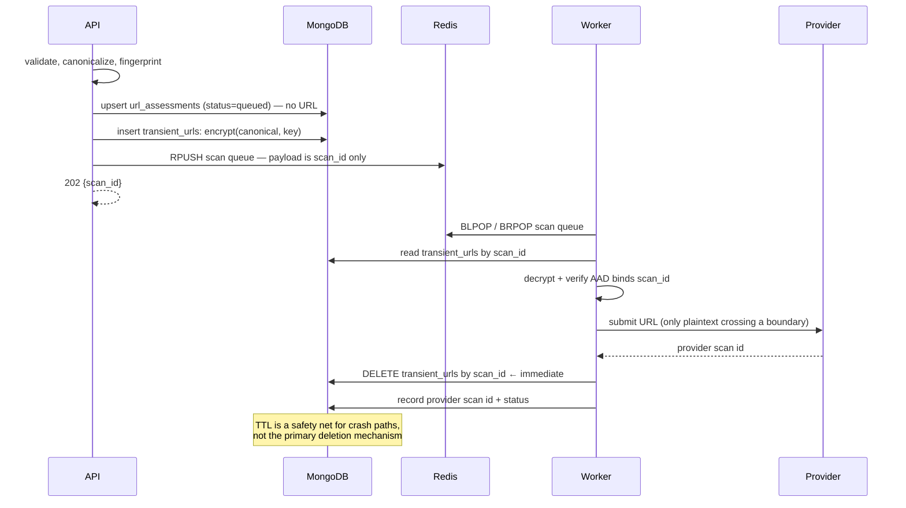

# 0013 — Durable jobs: scan IDs in the queue, encrypted transient URLs

- **Status:** Accepted
- **Date:** 2026-10-16
- **Supersedes:** [ADR 0003](0003-asynchronous-analysis-jobs.md)
- **Affects:** `data-model.md`, `architecture.md`, `security-and-privacy.md`,
  `implementation-plan.md`

## Context

[ADR 0003](0003-asynchronous-analysis-jobs.md) proposed a MongoDB-backed job
queue and flagged an unresolved tension:

> The queue is durable, so the URL must survive a restart — but the privacy
> design forbids storing raw URLs.

Redis is now confirmed as part of the MVP
([ADR 0017](0017-redis-in-the-mvp.md)), which makes the tension sharper, not
easier: a Redis queue is backed up, replicated, inspectable with
`redis-cli KEYS`, and frequently retained longer than a MongoDB TTL index.

CyberGuard's central promise is that raw URLs are never retained. A queue
payload containing plaintext URLs would falsify that promise for as long as the
queue entry exists, and would do so in the least controlled store in the system.

The tension is unavoidable: the job must be durable, and the worker must
eventually have the URL to submit. The question is only **where the URL lives,
in what form, and for how long**.

## Decision

**Queue payloads contain scan IDs only. Raw URLs are encrypted at rest,
stored in a dedicated short-lived collection, and deleted the moment they are
no longer required.**

### Queue payload

```json
{ "scan_id": "scan_01XYZ", "submitted_at": "2026-10-16T12:00:00Z" }
```

Opaque, minimal, and safe to inspect in Redis. A queue dump reveals which
scans exist and nothing about what was scanned. The unique `scan_id` also
gives job deduplication directly.

### Transient URL storage

The encrypted URL lives in a dedicated MongoDB collection, **not** in Redis
and **not** on the job document.

```json
{
  "_id": "scan_01XYZ",
  "ciphertext": "<base64>",
  "nonce": "<base64, 96-bit, random per record>",
  "created_at": "2026-10-16T12:00:00Z",
  "expires_at": "2026-10-16T12:05:00Z"
}
```

```javascript
db.transient_urls.createIndex(
  { expires_at: 1 },
  { expireAfterSeconds: 0, name: "ttl_transient_urls" }
)
```

### Lifecycle



Deletion is **explicit and immediate** after the submission attempt, whatever
its outcome — not delegated to the TTL index. The TTL index exists only to
clean up after a worker crash between storing and deleting.

The plaintext is deleted even when the submission failed, including when it
failed *ambiguously* and might be retried. That is deliberate: the alternative
is holding a plaintext URL for the duration of a retry backoff, in exchange for
saving one client round trip. The client re-submits instead, which is bounded by
the per-fingerprint budget.

## Dispatch: MongoDB is the ledger, Redis is delivery

The workflow spans four writes to two systems, and MongoDB plus Redis is not one
transaction. The phase-4 implementation orders them:

```
validate → canonicalise → fingerprint → fresh-assessment lookup
  → PutTransientURL    (encrypted input, keyed by a scan ID not yet in use)
  → CreateScan         (deduplicated by a partial unique index)
  → Enqueue            (scan ID only)
```

### Why the URL is written before the scan

It reads backwards and is the single most important ordering decision here.

The reverse order — create the scan, then store the URL — creates a scan that is
durably recorded, awaiting a worker, with no input any worker could ever read.
That scan is permanently stuck and needs an operator.

In the chosen order, a crash between the two writes leaves an encrypted URL with
no scan: garbage the TTL index removes, no stuck scan, and a client that
received no scan ID and will simply try again.

### Why the reconciler exists

The unavoidable non-atomic gap is that a scan can be durably recorded while the
enqueue fails, or succeed and then be lost to a Redis restart. Nothing in Redis
can repair this, because Redis does not know the scan exists.

MongoDB can. The reconciler treats MongoDB as the authoritative record and
re-enqueues any scan still in `queued` or `running` whose `updated_at` is older
than the stall threshold. **A lost queue message therefore degrades to a delay of
one stall threshold plus one tick; it cannot become a lost scan.**

A scan past its retry budget is failed outright rather than re-enqueued, so a
permanently failing URL cannot loop forever.

### Why not a transactional outbox

An outbox would make the enqueue atomic with the scan write, but only inside a
MongoDB **replica set**. The default deployment is a standalone server with no
transactions at all, so the reconciler is not a simplification here — it is the
only design the supported deployment topology allows.

### Why there is no in-flight list

The conventional reliable-queue pattern is `BRPOPLPUSH` into an in-flight list
with a lease, recovering seconds rather than minutes. It was rejected because it
adds a second piece of state that can disagree with the first: a message stuck
in the in-flight list because the reaper died, or a message removed from it by a
completion that never happened. MongoDB already provides exactly-once recovery
for the thing that matters, so the extra state buys latency, not correctness.

The cost is honest: recovery latency is the stall threshold plus one tick, not
one second. For a sandbox detonation that is irrelevant.

### Delivery is at-least-once, and every stage tolerates it

A job for a finished scan is a no-op. A job for a scan holding a provider job ID
resumes polling rather than submitting again. A verdict write is an upsert keyed
by fingerprint. The one thing never repeated is a provider submission — see
`internal/scans/worker.go`, which explains why a submission cannot be safely
retried when its outcome is unknown.

### Queue ordering

Producers `RPUSH` to the tail and consumers `BLPOP` from the head, which is
FIFO. `BRPOP` — the tempting shorthand — pops from the tail and would reverse
the queue, analysing a burst of submissions in the opposite order to the one they
arrived. This was caught by an integration test, not by reading the docs.

## Encryption design

- **Algorithm:** AES-256-GCM. Authenticated encryption: tampering is detected,
  not silently decrypted into garbage.
- **Key:** `URL_ENCRYPTION_KEY`, from the environment, ≥ 32 random bytes.
- **Nonce:** 96 bits, cryptographically random, unique per record, stored with
  the ciphertext. Never reused.
- **AAD:** the `scan_id`. Binds ciphertext to its record, so an attacker who
  can write to the collection cannot swap one scan's encrypted URL into another
  scan's slot and have the worker submit the wrong URL.
- **Plaintext:** held in memory only for the duration of the submission, then
  the reference is dropped.

### Key separation

`URL_ENCRYPTION_KEY` and `URL_FINGERPRINT_HMAC_KEY` are **separate secrets**
with different lifecycles:

| Property | HMAC fingerprint key | URL encryption key |
|---|---|---|
| Purpose | Stable lookup identity | Confidentiality of transient payloads |
| Stability | Must never change; rotation invalidates the entire cache | Rotatable; rotation only strands in-flight jobs |
| Scope | Long-lived | Short-lived data |
| Compromise impact | Every stored fingerprint becomes reversible | In-flight URLs (minutes of exposure) |

Using one key for both would couple a routine rotation to a full re-scan.
Separation of duties is the point.

## Consequences

**Positive**

- The queue — the store most likely to be inspected, replicated or backed up —
  contains no URLs.
- Exposure of a compromised URL blob is bounded by the TTL and the deletion
  path, not by queue retention.
- Authenticated encryption detects tampering rather than decrypting garbage.
- AAD binding prevents ciphertext-swap attacks.
- The privacy claim stays true: the raw URL exists in exactly two places, both
  transient and both controlled.

**Negative**

- An extra round trip per job: claim, read ciphertext, delete.
- A crash between store and delete leaves an encrypted URL until TTL. This is
  the one residual exposure window, bounded to minutes.
- Encryption adds a failure mode: a worker cannot decrypt cannot submit. Handled
  by a typed error that fails the job rather than crashing the worker.
- Two secrets to manage instead of one.

## Alternatives considered

| Alternative | Why rejected |
|---|---|
| Plaintext URL in the queue payload | Falsifies the core privacy promise in the least controlled store. Rejected outright |
| Plaintext URL in the job document | Same problem, in MongoDB, with the same crash-window exposure |
| No queue — submit synchronously, then enqueue only polling | Fast submission avoids durable plaintext, but ties a worker slot to a provider round trip and loses at-least-once delivery for the most important step |
| Derive the URL from the fingerprint | Impossible. The HMAC is one-way; this is exactly the property that makes the fingerprint private |
| Rely on MongoDB encryption at rest | Protects the disk, not a database dump, query log or backup |
| Submit inline in the API process before enqueueing | Holds an HTTP request across a provider round trip, violating the async requirement |

## Residual risk

A worker that crashes after `read transient_urls` but before `DELETE` leaves an
encrypted URL until TTL. Accepted: bounded, encrypted, and strictly better than
the alternatives. The TTL must be short — minutes, not hours — and configured,
not hard-coded.