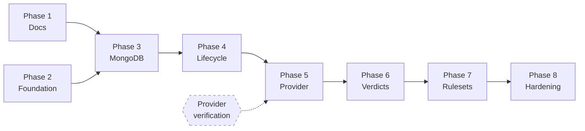

# CyberGuard AI — Implementation Plan

> **Status:** Proposed. Phase 1 (this documentation set) is complete and
> awaiting approval. Phases 2 and part of 3 exist as a skeleton.
> **Team assumption:** 1–2 developers. Phases are sized for that.

## 1. Phase status

| Phase | Status |
|---|---|
| 1. Architecture and documentation | ✅ Complete |
| 2. Go foundation, config, logging, health | ✅ **Complete** — module, config, slog, HTTP server, graceful shutdown, liveness/readiness, MongoDB connectivity, Docker Compose, OpenAPI, unit and integration tests, mock provider |
| 3. MongoDB, URL intelligence, indexed lookup | ✅ **Complete** — `scans` / `assessments` / `transient_urls` repositories, indexes including the partial unique dedup index, verdict cache with expiry, AES-256-GCM transient URLs, and the `urlintel` rename with the Public Suffix List |
| 4. Scan lifecycle, async jobs, dedup | ✅ **Complete** — `internal/scans`: submit → dedup → claim → submit to provider → poll → normalise → cache → serve; the `scans` collection as the work queue with lease-based claiming, reconciler, in-process scan runner, SSRF gate |
| 5. Hybrid Analysis integration | ✅ **Complete** — contract verified against the official OpenAPI document; adapter, verdict normalisation and tests in place. Nine specification gaps remain open ([V1–V9](hybrid-analysis-integration.md#10-open-questions-requiring-manual-verification)) |
| 6. Verdict normalisation, result retrieval | ✅ **Complete** — normalisation, persistence and status retrieval all land with the scan runner in Phase 4 |
| 7. Abuse controls (ADR 0014) | ✅ **Complete** — in-process fixed-window per-client and per-fingerprint limits, fail closed, `X-RateLimit-*` headers |
| 8. Versioned rulesets, extension API | ✅ **Complete** — `internal/rulesets` policy + DNR generation + validation, versioned snapshots, ETag/304, `unchanged` and `X-Ruleset-Rolled-Back` |
| 9. Chrome extension | ⬜ Not started — out of scope for the backend |
| 10. Hardening, CI, deployment | ⬜ Not started — no CI pipeline yet; every check is run by hand |

**Not started, and deliberately so.** The Chrome extension is a separate work
item and was explicitly out of scope. The protection ruleset **backend** is
implemented; no client-side code of any kind was written.

## 1a. Phase 4 — End-to-end scan workflow ✅

**Delivered.** `internal/scans` (lifecycle, runner, target gate),
`internal/ratelimit`, `internal/platform/mongoqueue` (claim leases over the
`scans` collection), `internal/memstore` test doubles, `internal/app` wiring,
and a single entry point — `cmd/api` — serving the API and running the pipeline.

**Verified.** `gofmt`, `go vet`, `go build`, `go test`, `go test -race`, unit
tests, and integration tests against live MongoDB 9 — including a full submit →
analyse → verdict cycle with the mock provider. Redis is no longer a test
dependency; see [ADR 0019](decisions/0019-mongodb-queue-and-in-process-runner.md).

### The workflow, as implemented

```
POST /api/v1/check-url
  → validate · canonicalise · fingerprint (HMAC)
  → refuse loopback/private/reserved hosts
  → fresh-assessment lookup → 200 with the verdict, or continue
  → per-fingerprint budget check            ← charged only on a real submission
  → PutTransientURL                         ← AES-256-GCM, scan ID as AAD
  → CreateScan                              ← partial unique index deduplicates
  → 202 {scan_id, status_url}                ← the scan document is the work;
                                              it is already claimable

scan runner (goroutines inside cmd/api)
  → ClaimNextScan: one atomic FindOneAndUpdate ← stamps lease_owner + expiry
  → GetScan (terminal? → release the lease)
  → TakeTransientURL                        ← read and delete in one operation
  → SubmitURL → RecordProviderSubmission    ← persisted immediately
  → poll with backoff → RecordProviderState
  → NormaliseVerdict → PutAssessment → ScanCompleted
  → DeleteTransientURL (already gone by then)

GET /api/v1/get-url/{scanId}
  → ScanResult; verdict present only when completed and still fresh
```

The second block is not a separate process. It is goroutines in the same binary
as the listener, which is why the `202` above is returned before any of it
happens: no HTTP request is ever waiting on an analysis, and a detonation that
takes minutes changes nothing about how long a connection is held open. The
decoupling that mattered was between the *request* and the *analysis*, not
between two processes.

### Three decisions worth recording

**The URL is stored before the scan, not after.** Creating the scan first can
strand one that is durably recorded but has no readable input. Storing the URL
first can only leave an orphaned encrypted record, which the TTL reaps. Details
and the full crash analysis: [ADR 0013](decisions/0013-durable-jobs-and-url-privacy.md#dispatch-mongodb-is-the-ledger-redis-is-delivery).

**A submission is never retried.** `POST /submit/url` declares no idempotency
token, so a timed-out request may already have been accepted. Resubmitting could
create a second sandbox job and spend quota twice, undetectably. The scan ends
as `submission_outcome_unknown` and the client re-requests. The one exception is
a `429`, which is a definitive refusal and therefore provably not an acceptance.

**A failed analysis writes no assessment at all.** Caching an `unknown` verdict
for the freshness window would freeze a transient provider outage into the cache
and suppress re-checking for hours. A verdict is only cached for an analysis that
actually completed and did not fail — which is what keeps `no_threat_detected`
reachable only through a recognised classification on a successful analysis.

### The claim was verified against a real MongoDB, not assumed

Two properties of the claim are properties of the server, and only a real server
proves them:

- **`FindOneAndUpdate` is atomic per document**, so two claimants can never
  receive the same scan. `TestClaimIsExclusive` races twelve of them against a
  live `mongod` and asserts one winner. A double would have merely restated the
  assumption.
- **An absent field does not satisfy a date comparison.** `{"available_at":
  {"$lte": now}}` does not match a document where `available_at` is missing, so
  the filter carries an explicit `$exists` branch. Without it every scan written
  before the lease fields existed would have been stranded for ever, and no
  error would have been raised —
  `TestScansWithoutLeaseFieldsAreStillClaimable` is the test that catches it.

Three queue bugs were found the same way when delivery lived in Redis — a LIFO
`BRPOP`, a sub-second block rounding to block-forever, and a driver that honoured
a deadline but not a cancellation. None were in our logic; all were in how the
broker's primitives behave under conditions a unit test would have modelled from
assumption. The Redis code and its tests are gone; the lesson is the reason
these two tests exist in this shape.

## 2. Phase 1 — Architecture and documentation ✅

**Scope.** Review the existing repository, resolve contradictions, produce the
architecture set.

**Deliverables.** This directory: `architecture.md`, `api-contract.md`,
`data-model.md`, `module-map.md`, `security-and-privacy.md`,
`hybrid-analysis-integration.md`, `docker-development.md`,
`testing-strategy.md`, `implementation-plan.md`, and `decisions/`.

**Acceptance criteria.**

- [x] Contradictions in the prior documents identified and resolved explicitly.
- [x] Mermaid diagrams for architecture, sequence, modules, state machine and
      ruleset sync.
- [x] Provider details not invented; unverified items recorded as open
      questions.
- [x] Assumptions and trade-offs documented.
- [x] Existing working code preserved and assessed, not discarded.

**Risks.** The largest risk is approving a plan whose provider integration is
unverifiable. Phase 5 is therefore gated, not merely sequenced.

## 3. Phase 2 — Go foundation ✅ (partial)

**Scope.** Module, configuration, logging, health endpoints, HTTP skeleton,
Docker.

**Delivered.** `cmd/api`, `cmd/migrate`, `internal/{config,logging,httpapi,
urlintel}`, multi-stage Dockerfile, Compose topology. Verified: build, vet,
gofmt, tests, live HTTP smoke test.

**Remaining.** OpenAPI document; CI pipeline; coverage gate; readiness
sub-checks for MongoDB and the provider; a draining flag so a load balancer
stops routing before shutdown.

**Acceptance criteria.**

- [x] `go build ./...`, `go vet ./...`, `gofmt -l .` clean.
- [x] Tests pass.
- [x] `/health/live` and `/health/ready` respond correctly.
- [x] No root-owned files in the working tree.
- [ ] CI gates every commit.
- [ ] Readiness reflects MongoDB and provider state.

**Risks.** Low. The skeleton is small and reversible.

## 4. Phase 3 — MongoDB persistence

**Scope.** Collections, indexes, repositories, exact-URL lookup.

**Deliverables.**

- `internal/platform/mongostore` — connection, pooling, index creation, driver
  error translation.
- Repository implementations of the consumer-defined interfaces from
  `module-map.md` §5.
- Index creation as an idempotent migration step, **run separately from
  application startup** — never on boot.
- Scan CRUD: `CreateScan` with dedup, `GetScan`, `UpdateScanStatus`,
  `RecordProviderSubmission`, `ListStalledScans`.
- Assessment CRUD: `PutAssessment`, `FindFreshAssessment`, `ExpireAssessment`.
- `internal/urlnorm` renamed to `internal/urlintel`, with
  `golang.org/x/net/publicsuffix` — see [ADR 0012](decisions/0012-public-suffix-list-dependency.md).

**Dependencies.** Phase 2.

**Acceptance criteria.**

- [ ] Unique index on `url_fingerprint` enforced by the database.
- [ ] TTL index on `expires_at` deletes an expired document.
- [ ] Concurrent upserts of one fingerprint yield one document.
- [ ] Driver errors (`ErrNoDocuments`) never escape the platform layer.
- [ ] Registrable-domain extraction correct across a PSL corpus.

**Tests.** Layer 4 — integration tests behind `//go:build integration` against
real MongoDB. Unit-test the BSON mapping separately.

**Risks.**

- *TTL deletes more than intended.* Mitigation: distinct collections, documented
  retention, integration test proving the TTL behaviour.
- *Index drift between environments.* Mitigation: index creation is an
  idempotent migration with a version record, not a startup side effect.

## 5. Phase 4 — Scan lifecycle and jobs

**Scope.** The state machine, the work queue, and the deduplication guarantee.

**Deliverables.**

- `internal/scans` — lifecycle, transitions, retry policy.
- `internal/platform/mongoqueue` — the `scans` collection behind the delivery
  interface: atomic claim, time-bounded lease, lease expiry, retry deferral.
- In-process scan runner: claim → submit → poll → normalise → persist → maybe
  bump ruleset. Started by `cmd/api` on its own goroutines.
- Indexes from `data-model.md` §2, including `by_claimable`.

**Dependencies.** Phase 3.

**Acceptance criteria.**

- [ ] N concurrent identical requests produce **exactly one** claimable scan and
      one shared `scan_id`.
- [ ] A `kill -9`'d consumer's scan is recovered once its lease lapses, with no
      sweeper and nothing running to notice.
- [ ] Retries are bounded, jittered, and stop at `max_attempts`.
- [ ] Illegal state transitions are rejected.
- [ ] No goroutine leaks (`goleak`).
- [ ] The lease is derived from the poll deadline and validated, not configured.

**Tests.** Layer 3 with fakes, plus a concurrency test under `-race`; Layer 4
for the claim query, against a real MongoDB — see
[`testing-strategy.md` §6](testing-strategy.md#6-layer-4--mongodb-integration).

**Risks.**

- *Duplicate provider submissions from a TOCTOU race.* Mitigation: atomic
  `findOneAndUpdate`, never check-then-insert, and a lease that provably
  outlives the longest unit of work. This is the central risk of the phase and
  deserves the most test attention.
- *A lease shorter than the work it covers.* This would let a second consumer
  start on a scan whose analysis is still running, and on the submission path
  that is a second submission of the same URL. Mitigation: the lease is derived
  from `WORKER_POLL_DEADLINE` and a non-positive headroom is a config error, so
  no setting produces it.
- *Submitting a URL without the URL being durable.* See open question 4.

## 6. Phase 5 — Hybrid Analysis integration ⛔ BLOCKED

**Scope.** The provider adapter.

**Blocked on.** All 15 items in
[`hybrid-analysis-integration.md` §9](hybrid-analysis-integration.md#9-verification-checklist)
being resolved against official documentation.

**Deliverables.**

- `internal/providers/hybridanalysis` — the only package aware of the provider.
- Error-code mapping, retry classification, polling with jittered backoff.
- Recorded fixtures for every provider response shape.

**Acceptance criteria.**

- [ ] All ⬜ items in the verification checklist resolved with citations.
- [ ] Provider wire types do not escape the adapter package.
- [ ] The API key appears in no log, error or response.
- [ ] Every failure path maps to a stable CyberGuard error code.
- [ ] No test performs a live submission.

**Tests.** Layer 5 with `httptest.Server`.

**Risks.**

- *Unverified contract produces code that fails in production.* Mitigation:
  the hard gate above. Do not start on recollection.
- *Licence or quota terms prohibit the intended use.* Mitigation: resolve
  open question 1 before writing any code. This is a business blocker, not a
  technical one.
- *Ambiguous submission timeout causes duplicate scans.* Mitigation: depends
  on whether the provider offers an idempotency token (Q3).

## 7. Phase 6 — Verdict normalization

**Scope.** `internal/verdicts`; result retrieval.

**Deliverables.** Provider state → CyberGuard verdict mapping; verdict
persistence; `GET /api/v1/get-url/{scanId}` returning real records.

**Acceptance criteria.**

- [ ] Every provider state maps to exactly one verdict.
- [ ] **No error path yields `benign`** — enforced by a meta-test over all
      failure paths.
- [ ] `verdict` appears only when `scan_status == completed`.
- [ ] `unknown` is reachable and distinct from `benign`.

**Tests.** Layer 8 verdict tables; exhaustive and pure.

**Risks.** *A default branch that maps "unrecognised" to `benign`.* Mitigation:
the failure-walk meta-test; review the default case specifically.

## 8. Phase 7 — Rulesets and extension API

**Scope.** `internal/rulesets`; `GET /api/v1/get-all`.

**Deliverables.** Eligibility policy; DNR rule generation; schema validation;
versioned snapshots; `ETag`; conditional responses.

**Acceptance criteria.**

- [ ] Only policy-eligible verdicts produce rules.
- [ ] An unchanged effective rule set does **not** increment the version.
- [ ] Versions are monotonic under concurrency.
- [ ] One invalid rule fails the whole snapshot — no partial rulesets.
- [ ] Rule scope is the narrowest defensible one.
- [ ] `GET /get-all` returns `304`/`unchanged` correctly.

**Tests.** Layer 9 ruleset tables, plus an integration test against real
MongoDB for version atomicity.

**Risks.**

- *Every scan bumps the version*, so extensions re-download constantly.
  Mitigation: byte-comparison before increment, plus a test asserting
  stability.
- *Over-broad rules block legitimate traffic.* Mitigation: strict scope
  policy; treat any domain-level rule as requiring exceptional evidence.

## 9. Phase 8 — Hardening and deployment

**Scope.** Rate limiting, metrics, tracing, CI, fuzzing, security review.

**Deliverables.**

- Rate limiting per the contract.
- Metrics: cache hit rate, time from scan creation to first claim, provider
  latency, failure and timeout counts, polling volume — **without
  request-derived labels**.
- OpenTelemetry tracing with request-ID correlation.
- CI: `go vet`, `staticcheck`, `go test -race -coverpkg=./...`, `govulncheck`,
  coverage floor.
- Fuzz targets for `Validate` and JSON decoding.
- Production deployment notes.

**Acceptance criteria.**

- [ ] All MVP criteria in `testing-strategy.md` §12 checked.
- [ ] Rate limits enforced and `429` documented.
- [ ] No high-cardinality metric labels.
- [ ] Secrets injected at runtime, never baked into images.
- [ ] Databases not published.

**Tests.** Everything, including the E2E flow.

**Risks.** *Rate limiting misconfigured into a denial-of-service vector.*
Mitigation: generous defaults, per-fingerprint caps, monitored thresholds.

## 10. Critical path



**Phase 5 is gated on documentation verification, not on engineering
capacity.** Starting it early is the most likely way to waste quota and
produce a broken adapter.

## 11. Open questions — all resolved

Every question raised by the architecture review is closed by a decision record.

| # | Question | Resolution |
|---|---|---|
| 1 | Does the Hybrid Analysis licence permit automated URL submission? | Written approval required before commercial release; development is private/self-hosted against fakes. [ADR 0010](decisions/0010-hybrid-analysis-licensing.md) |
| 2 | Is `benign` acceptable as a verdict name? | Replaced by `no_threat_detected`, which cannot be misread as a guarantee. [ADR 0011](decisions/0011-verdict-semantics-no-threat-detected.md) |
| 3 | Is a Public Suffix List dependency acceptable? | Yes — `golang.org/x/net/publicsuffix`, the module's first external dependency. [ADR 0012](decisions/0012-public-suffix-list-dependency.md) |
| 4 | How can the queue be durable without retaining raw URLs? | Queue payloads carry scan IDs only; raw URLs encrypted and deleted immediately. [ADR 0013](decisions/0013-durable-jobs-and-url-privacy.md) |
| 5 | How is an unauthenticated endpoint protected? | Rate limits, quotas, request limits and concurrency controls are mandatory. [ADR 0014](decisions/0014-abuse-protection-without-authentication.md) |
| 6 | Adopt OpenAPI and RFC 9457? | Both adopted; must land before the extension ships. [ADR 0015](decisions/0015-openapi-and-rfc-9457.md) |
| 7 | What is the real module path? | Derived from the Git remote. **Currently a placeholder — see D1.** [ADR 0016](decisions/0016-go-module-path.md) |
| 8 | Keep Redis in the MVP? | **No — reversed.** It was the queue and the rate-limit counter store; both moved in-process, and Redis is gone. [ADR 0019](decisions/0019-mongodb-queue-and-in-process-runner.md) supersedes [ADR 0017](decisions/0017-redis-in-the-mvp.md) |

### Outstanding deviations

| # | Deviation | Why | Action required |
|---|---|---|---|
| D1 | Module path is `cyberguard/server`, not a fetchable repository path | **No Git remote and no commit exist**, so the path cannot be derived without guessing | Set the remote, then rewrite the path. **Blocks Phase 4** — see [ADR 0016](decisions/0016-go-module-path.md) |
| D2 | ~~`internal/urlnorm` not renamed to `urlintel`~~ | **RESOLVED** | Renamed to `internal/urlintel` with the PSL swap. `httpapi` updated |
| D3 | `AnalysisProvider` lives in `internal/providers`, not its consumer `internal/scans` | `internal/scans` now exists and consumes the contract, which is the consumer-side arrangement that matters. The contract was **not** moved, because a move rewrites imports across four packages and ~40 existing provider tests for no functional gain. The live concern is that adapters and the contract sit together | Optionally, as a standalone cleanup with no behaviour change |
| D4 | No CI pipeline | Not in scope for Phase 1 | Add `vet`, `staticcheck`, `test -race`, `govulncheck` and the OpenAPI drift check |
| D5 | No `golangci-lint` | Avoided an extra dependency for Phase 1 | Add with CI |

### Launch blockers

Two items must be closed before commercial release. Both are ADRs rather than
tasks, because each changes what the system may do:

1. **[ADR 0010](decisions/0010-hybrid-analysis-licensing.md)** — written
   approval for Hybrid Analysis usage.
2. **[ADR 0019](decisions/0019-mongodb-queue-and-in-process-runner.md)** — the
   rate-limit counters are per-process, so **the configured limits are per
   replica**. A single-replica deployment is fine; three replicas allow three
   times the configured submission rate against a provider quota that is billed.
   Scaling out horizontally requires moving the counters to a shared store
   behind the unchanged `ratelimit.Limiter` interface before the second replica
   exists, not after.

### Still unverified

The fifteen provider-specific technical questions in
[`hybrid-analysis-integration.md` §9](hybrid-analysis-integration.md#9-verification-checklist)
remain open. No decision can close them — they require the official
documentation.

## 12. Deliberate deferrals

| Item | Why |
|---|---|
| Elasticsearch | Exact-URL lookup is a keyed fetch. Revisit only on measured search needs |
| Custom Go sandbox | Out of scope by explicit project decision |
| Accounts, SSO, dashboard | Not needed for the core loop |
| Microservices | No scaling or isolation pressure yet |
| Multi-tenancy | No requirement yet |
| Observability platform | Structured logs first; metrics and traces in Phase 8 |