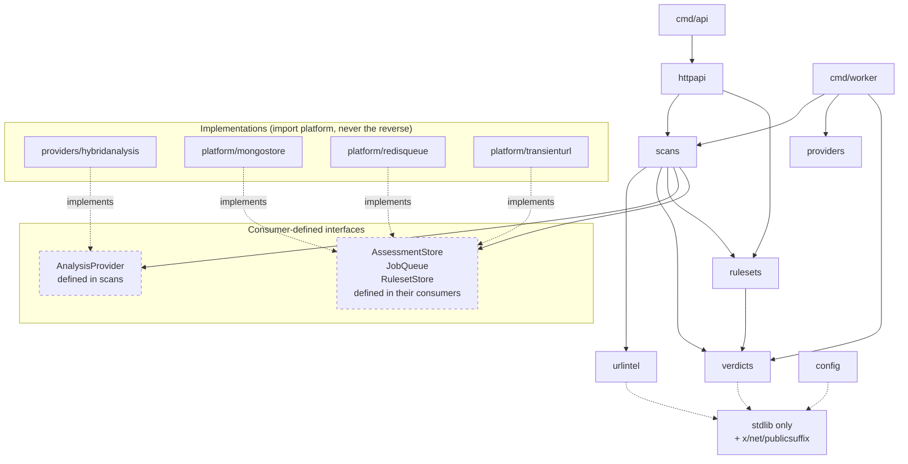

# CyberGuard AI — Module Map

> **Status:** Proposed. Describes the target layout. Current state is in §7.

## 1. Layout

```text
server/
├── cmd/
│   ├── api/                     # package main — wiring only
│   └── worker/                  # package main — wiring only
├── internal/
│   ├── config/                  # env loading, validation
│   ├── app/                     # wiring shared by api and worker
│   ├── logging/                 # slog construction
│   ├── httpapi/                 # transport: routing, middleware, DTOs
│   │   └── docs/                # Swagger UI + the embedded contract
│   ├── urlintel/                # validate · canonicalize · fingerprint · PSL hosts
│   ├── scans/                   # scan lifecycle: submit · dedup · dispatch · poll · verdict
│   ├── ratelimit/               # Redis fixed-window counters (ADR 0014)
│   ├── verdicts/                # CyberGuard verdict vocabulary
│   ├── memstore/                # in-memory Store/Queue for tests
│   ├── providers/               # AnalysisProvider contract
│   │   ├── hybridanalysis/      # real adapter — the only HA-aware package
│   │   └── mock/                # deterministic fake for tests
│   └── platform/                # infrastructure implementations
│       ├── mongostore/          # MongoDB repositories
│       └── redisqueue/          # scan queue (scan IDs only) + rate-limit storage
└── go.mod
```

`internal/memstore` is an in-memory implementation of the persistence and queue
interfaces, not a mock. It reproduces deduplication, AES-256-GCM with the scan
ID as additional authenticated data, and read-and-delete semantics, because the
behaviour under test is *ordering* and a call-recording stub cannot express it.
The integration tests use the real MongoDB and Redis instead.

`go.mod` currently declares `cyberguard/server`, which is not a fetchable
repository path. It must be derived from the Git remote —
[ADR 0016](decisions/0016-go-module-path.md).

Docs and deployment live at the repository root, outside the Go module:
`docs/`, `docker-compose.yml`, `README.md`.

## 2. Dependency direction

Dependencies point inward. `domain` logic never imports transport, MongoDB, or
a provider's wire types.



Dashed boxes are **interfaces owned by their consumer**. `platform/` and
`providers/` import them; the consumers never import the implementations. The
compiler enforces most of this for free, because `internal/` plus a
consumer-defined interface means an import cycle is simply impossible to write.

### Why the interfaces live with the consumers

`AnalysisProvider` is declared inside `scans`, not inside `providers`. If
`providers` declared it, then adding a method to the provider package would
force every consumer to recompile against a larger surface it does not need,
and `scans` would have to import `providers` — reversing the arrow.

Go interfaces are implicit. `*hybridanalysis.Client` satisfies
`scans.AnalysisProvider` without declaring it. The compile-time assertion
`var _ scans.AnalysisProvider = (*Client)(nil)` catches drift at build time.

## 3. Package responsibilities

### `cmd/api`, `cmd/worker`

Parse flags, load config, construct dependencies in a deliberate order, start,
handle signals, exit. **No business logic.**

- `os.Exit` appears exactly once, in `main`.
- No `init()` functions for wiring.
- Everything testable lives behind `run(ctx, deps) error`.

Both binaries share wiring code. Factor it into a small `internal/app` package
once the second constructor exceeds a handful of lines — not before.

### `internal/config`

Loads the environment, validates it, and **lists every problem at once** rather
than failing on the first. Returns a plain struct with no behaviour.

A missing optional secret is not a startup error: the service must boot and
report its own readiness honestly.

### `internal/logging`

Builds the `log/slog` handler. Knows nothing about the domain.

Redaction is *not* implemented here. Silently mutating a log field hides bugs;
callers must not pass raw URLs at all. An automated test enforces that rule
rather than a runtime filter.

### `internal/urlintel`

Pure functions over strings and `net/url`. No I/O, no context, no logging.

- `Validate(raw) (*url.URL, error)`
- `Canonical(*url.URL) string`
- `Fingerprint(key []byte, canonical string) (string, error)`
- `RegistrableDomain(host string) string` — wraps
  `golang.org/x/net/publicsuffix.EffectiveTLDPlusOne` per
  [ADR 0012](decisions/0012-public-suffix-list-dependency.md), the module's
  first external dependency. Returns a typed domain error when a host has no
  registrable domain.

This is the only package permitted an external dependency. Everything else
stays on the standard library.

### `internal/httpapi`

Transport only: routing, middleware, request decoding, status mapping,
response encoding.

Handlers hold dependencies on a struct and never touch MongoDB documents or
provider types directly. They translate between the wire and the application
layer's types and nothing more.

Middleware order, outermost first:

```text
Recoverer → RequestID → AccessLog → [RateLimit] → Auth → Handler
```

`Recoverer` must be outermost — an inner panic escapes the handler and takes
the process with it.

### `internal/httpapi/docs`

Static content: Swagger UI, the vendored assets it loads, and the contract.

It holds **no** dependency on the API — no store, no service, no provider — and
must not acquire one. Its inputs are the embedded `openapi.yaml` and the
`assets/` tree, both fixed at build time, so it stays available while the rest
of the service is degraded.

Two constraints are structural rather than stylistic:

- **The asset list is an explicit map.** Anything not named is not served, so
  a file dropped into `assets/` by accident is inert until someone adds it.
- **The page uses only relative URLs.** Served from `/docs/`, `assets/x.css`
  resolves to `/docs/assets/x.css` and `../openapi.yaml` to `/openapi.yaml`,
  independent of host, port or path prefix. This is why the route keeps its
  trailing slash, and why `.redocly.yaml` disables `no-path-trailing-slash`.

The contract is read from `cyberguard/server` (`spec.go`), which embeds
`server/openapi.yaml` at the module root. There is no second copy: the bytes
served are the bytes committed.

### `internal/scans`

The application core. Owns the lifecycle:

- Look up a fresh assessment by fingerprint.
- Atomically create or reuse an in-progress scan (the dedup guarantee).
- Enqueue a job.
- Drive state transitions.

Knows nothing about HTTP, and nothing about the provider's wire format.

### `internal/verdicts`

Maps provider results to CyberGuard verdicts. The single place where a
provider's vocabulary ends.

The rule that matters most in this package: **no failure path may produce
`no_threat_detected`.** A timeout, a `401`, a malformed response and an unsent
request are all `inconclusive` or `unknown`
([ADR 0011](decisions/0011-verdict-semantics-no-threat-detected.md)).

Pure and table-driven; it should be the most thoroughly tested package in the
repository.

### `internal/rulesets`

Turns eligible verdicts into validated `declarativeNetRequest` rules,
maintains the monotonic version, and publishes snapshots.

Keeps **analysis** and **policy** separate: `verdicts` decides what the
provider said, `rulesets` decides whether that warrants a browser rule. A
finding can be recorded without ever becoming a rule.

### `internal/ratelimit`

Enforces the four controls that stand in for authentication in v1
([ADR 0014](decisions/0014-abuse-protection-without-authentication.md)):
per-client and per-fingerprint rate limits, global quotas, and concurrency
semaphores.

Pure policy — it decides whether a request is allowed and with what
`Retry-After`. The counters it consults come from Redis, so this package does
not import a driver.

Quota exhaustion **fails closed**. If the counter store is unreachable, the
controls cannot be evaluated, so submissions stop rather than proceed
unguarded. That is a deliberate availability sacrifice: an unguarded endpoint
spends money.

### `internal/providers/hybridanalysis`

The only package that knows Hybrid Analysis exists. Owns authentication, HTTP,
wire types, retries, polling, and error mapping.

Must not leak provider field names upward. If `verdicts` ever references a
provider JSON tag, the boundary has been breached.

### `internal/platform/mongostore`, `internal/platform/queue`

Infrastructure. Owns connection pooling, index creation, driver-error
translation, and the atomic claim query.

Driver errors become domain errors here, so nothing above this layer ever sees
`mongo.ErrNoDocuments`.

## 4. Boundaries enforced by tests

Some rules deserve mechanical enforcement rather than review comments.

| Boundary | Enforcement |
|---|---|
| `urlintel` and `verdicts` stay pure | No `net/http`, `mongo-driver` or `os` imports; assert with an import-lint test or `go list -deps` check |
| No raw URL in any log | A test that drives every handler and greps the log buffer for the submitted URL (already implemented for `httpapi`) |
| No raw URL in metrics | Assert the metric label set contains no request-derived values |
| Provider wire types stay in the adapter | A test in `verdicts` asserting no import of `providers/hybridanalysis` |
| Platform does not import modules | Directional dependency check over `go list -deps` |
| Verdict purity | Table test asserting every error and timeout path maps to `inconclusive`/`unknown`, never `no_threat_detected` |
| No live provider calls in tests | Tests use a fake provider; a CI guard rejects network calls |

The "no raw URL in logs" test already exists in
`internal/httpapi/server_test.go` (`TestRawURLNeverReachesLogs`). It is the
single most valuable test in the repository and must never be deleted or
weakened.

## 5. Interface sketches

Small, consumer-defined, and verified at compile time.

```go
// internal/scans — what the scan lifecycle needs from any provider.
type AnalysisProvider interface {
    SubmitURL(ctx context.Context, rawURL string) (Submission, error)
    GetAnalysis(ctx context.Context, providerScanID string) (Analysis, error)
}

var _ scans.AnalysisProvider = (*hybridanalysis.Client)(nil)
```

```go
// internal/scans — what the scan lifecycle needs from storage.
type AssessmentStore interface {
    FindByFingerprint(ctx context.Context, fp string) (Assessment, error)
    UpsertPending(ctx context.Context, a Assessment) (Assessment, bool, error)
    MarkCompleted(ctx context.Context, scanID string, v verdict.Verdict, at time.Time) error
}

type JobQueue interface {
    Enqueue(ctx context.Context, job Job) error
    Claim(ctx context.Context, lease time.Duration) (Job, error)
    Complete(ctx context.Context, jobID string) error
    Retry(ctx context.Context, jobID string, nextAttemptAt time.Time, code string) error
}
```

Two methods each. No `Store` interface with fifteen methods that no caller
uses.

## 6. Rejected alternatives

| Alternative | Why not |
|---|---|
| Microservices | No scaling or isolation pressure. Adds network failure modes to a system whose hardest problem is already correctness of meaning. Revisit when worker throughput is measured, not assumed. |
| Repository base type with 12 methods | Callers need 2–4 methods. A wide interface is satisfied by fakes that hide the behaviour under test. |
| Events / pub-sub inside the monolith | Adds ordering and delivery guarantees nobody asked for. The queue is already the async boundary. |
| ORM for MongoDB | The atomic upsert and claim patterns are the core correctness mechanisms. An ORM hides exactly the semantics that matter here. |
| `pkg/` exported packages | Nothing outside this module consumes the code. `internal/` is enforced by the compiler. |
| Elasticsearch | Exact-URL lookup is a keyed document fetch. A search index would add a datastore, an eventual-consistency window and a rebuild path for zero benefit at MVP volume. |

## 7. Current vs target

| Package | Current | Target |
|---|---|---|
| `internal/config` | ✅ implemented and tested | unchanged |
| `internal/logging` | ✅ implemented | unchanged |
| `internal/health` | ✅ implemented and tested | unchanged |
| `internal/app` | ✅ shared datastore wiring | unchanged |
| `internal/urlnorm` | ✅ validation, canonicalisation, fingerprints | **✅ renamed `internal/urlintel`** + PSL. `host.go` holds `NormalizeHostname`, `RegistrableDomain`, `ParseHost` |
| `internal/httpapi` | ✅ routes, middleware, RFC 9457, OpenAPI drift check | grow handlers with the pipeline; add rate-limit and auth middleware in Phase 8 |
| `internal/platform/mongostore` | ✅ **repositories, indexes and transient-URL crypto** | add `host_signals` and `rulesets` — Phase 6/7 |
| `internal/platform/redisqueue` | ✅ connection, ping, idempotent close | add enqueue, claim and lease — Phase 4 |
| `internal/platform/transienturl` | ✅ shipped inside `platform/mongostore/transienturl.go` | unchanged |
| `internal/providers` | ✅ contract only (deviation D3) | move the contract into `internal/scans` — Phase 4 |
| `internal/providers/mock` | ✅ implemented and tested | moves with the contract |
| `internal/providers/hybridanalysis` | ❌ | new — blocked on verification **and** licensing approval |
| `internal/scans` | ❌ | new — Phase 4 |
| `internal/verdicts` | ❌ | new — Phase 6 |
| `internal/rulesets` | ❌ | new — Phase 7 |
| `internal/verdicts` | ✅ vocabulary, tested | unchanged |
| `internal/providers/hybridanalysis` | ✅ **implemented and tested** against `httptest` | unchanged; contract fully verified |
| `internal/ratelimit` | ❌ | new — Phase 8 |

`urlnorm` → `urlintel` shipped together with the PSL swap in one change, so
the rename never existed in a half-finished state where the package was named
for URL intelligence but contained no host intelligence.

### Where the provider mapping table lives

`internal/verdicts` owns the *vocabulary* — the five values and their meanings.
The *translation table* from Hybrid Analysis strings to those values lives in
`internal/providers/hybridanalysis`, because only an adapter that knows a
provider's strings can translate them. Putting the table in `verdicts` would
give that package a dependency on one specific provider, and the next provider
would either duplicate the table or grow a switch.